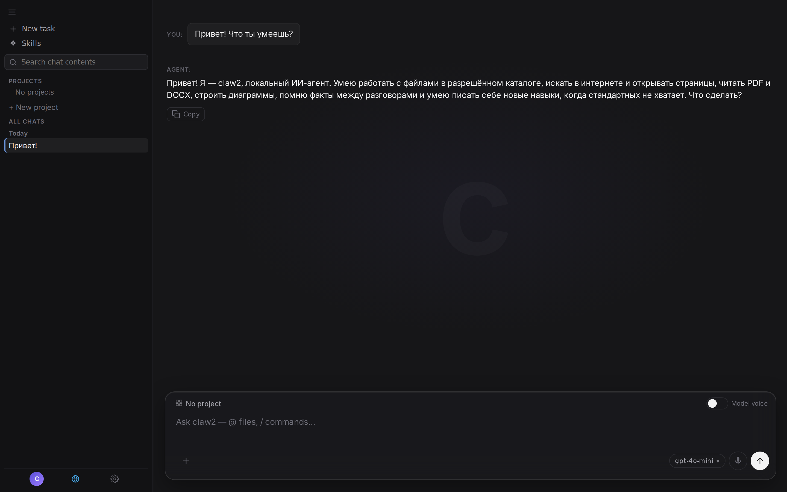
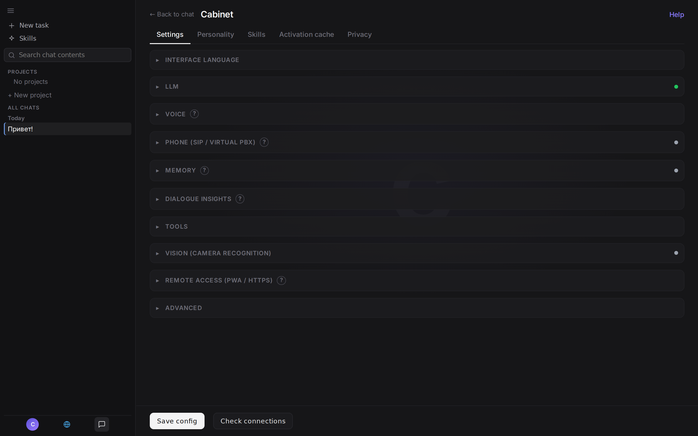

# claw2

[English](README.md) · [Русский](README.ru.md)

[](LICENSE)
[](docs/wiki/en/Home.md)

**A personal AI agent you host yourself.** It works with the language-model
provider of your choice — a cloud API or a local server such as Ollama or
LM Studio — and keeps conversations, files and long-term memory on your own
machine. What the built-in tools cannot do, it delegates to a skill: a
plain Node.js script that the agent can write itself and run after your
confirmation.

Security is on by default: the agent works inside a limited sandbox,
touches only the directories you allow, and records its actions in an
audit log. Conversations live in a local SQLite database; no cloud service
receives them — the only outbound traffic is the traffic you configure.

The distribution format is source code for self-hosting: a Linux machine
with Docker is all that is required, and a single container serves both
the web interface and the API.

<p align="center">
  
  
</p>

## Quick start

```bash
git clone https://github.com/bkisonka/claw2 claw2
cd claw2

# 1. Environment: the model API key and the gateway access key.
cp .env.example .env
openssl rand -hex 24   # generate the gateway key
nano .env              # paste it into .env as CLAW2_GATEWAY_API_KEY=<generated key>;
                       # put your model provider key into OPENAI_API_KEY

# 2. Configuration: create the agent config from the example.
cp .claw2/claw2.gateway.yaml.example .claw2/claw2.yaml
nano .claw2/claw2.yaml

# 3. Build and start.
docker compose up -d --build
```

Open **http://localhost:8080** — the web interface of the agent; it asks
for the gateway key on entry. Health state is reported at `GET /health`.

By default the port is published on the loopback interface only. To reach
the agent from other devices, change `127.0.0.1:8080:3000` in `compose.yml`
to `8080:3000` — gateway authentication (on in the example config) is what
protects the service once the port is reachable.

If you use a local model server on the host (for example Ollama on port
11434), the container reaches it at `http://host.docker.internal:11434/v1`
— put that address into `llm.baseURL` in the config.

## What it offers

- **A conversational agent with tools.** Beyond answering questions, claw2
  can read and write files in its workspace, fetch web pages, search the
  web, run calculations and call its skills — choosing a tool on its own
  from the description of your request.
- **Skills.** Anything the built-in tools cannot do is delegated to a skill:
  a small Node.js script in the `agents/` directory. Standard skills cover
  downloading files, reading PDF and DOCX documents, charts, weather and
  more. When no suitable skill exists, the agent can write a new one and
  start using it after your confirmation.
- **Fork and duplicate chats.** Branch a conversation from any message
  (the fork button next to "copy" under each reply) or duplicate the whole
  chat from the sidebar menu. The copy carries the history, project and
  model; generated files stay shared between the original and its forks;
  the sidebar shows the lineage as a tree, and deleting a chat re-attaches
  its forks to the parent so the chain of reasoning never breaks.
- **Activation cache (optional).** Export the trajectory of a successful
  deep conversation to a `.claw-cache` file and seed a new chat with it:
  the new session starts in the rebuilt context contour of that topic
  instead of a blank field. Managed in the cabinet's "Activation cache"
  tab (export, import, per-chat selection); in the compose delivery keep
  the cache directory inside the mounted `data/` volume (e.g.
  `./data/claw-cache`) so caches survive rebuilds.
- **Dialog stability (experimental).** A session-level controller tracks
  semantic entropy and coherence while the conversation unfolds; when the
  thread starts to drift it switches the model into a stricter answering
  mode and recalls what the session was about. Every threshold is a
  visible config number and the whole layer can be disabled for a
  before/after comparison (`orchestrator.hss.enabled`).
- **Long-term memory.** The agent remembers facts between conversations and
  recalls the relevant ones before each answer. Memory is stored locally.
- **Reminders.** One-off or recurring reminders (daily, every 3 days or
  weekly) are created in chat and delivered to Telegram when due.
- **Web interface.** A full chat front-end with sessions, settings and
  attachments, served by the same container.
- **A mobile web client.** A standalone installable web application (under
  `/pwa/`) that runs entirely in the browser and talks to the model provider
  directly — handy on a phone, at home or over the network.
- **Messengers.** A Telegram bot can serve as another door into the same
  agent; voices messages are understood and answered with speech when a
  speech service is configured.
- **Honest accounting of the surroundings.** Every request the agent makes
  to the outside world passes through allow-lists and is written to the
  audit log.

## How it is put together

| Part | Where | Role |
|------|-------|------|
| Gateway | `src/gateway/` | The heart: HTTP API, chat sessions, tools, skills, memory, channels. Serves the web interface and the mobile client. |
| Web interface | `web/` | The browser front-end (React). |
| Mobile web client | `pwa/` | A self-contained web app; the agent logic runs inside the browser, data stays on the device. |
| Skills | `agents/` | Small Node.js scripts, editable on the host — the container picks them up in place. |
| Assistant persona | `prompts/` | The tone and manner of the assistant, separated from the machinery. |
| Configuration | `.claw2/claw2.yaml` | One YAML file for everything: model, gateway, memory, tools, channels. |

Conversations live in a local SQLite database; no cloud service receives
them. The only outbound traffic is the traffic you configure: calls to the
model provider and whatever the agent fetches on your behalf.

## Requirements

- Linux x86-64 or arm64 (Debian, Ubuntu, Fedora, Alpine and other common
  distributions work).
- Docker Engine 24 or newer with the Compose plugin.
- An API key for any OpenAI-compatible provider — a cloud service or a
  local server such as LM Studio or Ollama.

Building from source without Docker requires Node.js 22.13 or newer (CI uses Node.js 22).

## Configuration

Everything is configured in a single YAML file, `.claw2/claw2.yaml`. The
examples in `.claw2/` cover the typical setups; secrets are never written
into the file itself — write `env:OPENAI_API_KEY` and the value is taken
from the environment (from `.env`).

The most common settings:

```yaml
llm:
  provider: openai        # any OpenAI-compatible endpoint
  model: gpt-4o-mini
  baseURL: https://api.openai.com/v1   # or a local server
  apiKey: env:OPENAI_API_KEY

gateway:
  port: 3000
  auth:
    enabled: true
    apiKey: env:CLAW2_GATEWAY_API_KEY

memory:
  enabled: true

sandbox:
  useDocker: false        # inside the container, skills run in a node sandbox
  timeoutMs: 60000
```

The web interface has its own settings screen that edits the same file;
changes take effect after you press *Save and restart*.

Environment variables (`cp .env.example .env`):

| Variable | Purpose |
|----------|---------|
| `OPENAI_API_KEY` | The model provider key, referenced from the config as `env:OPENAI_API_KEY`. |
| `CLAW2_GATEWAY_API_KEY` | The key for the HTTP API and the web interface (required by the example config). |
| `TZ` | Time zone; the agent keeps track of the current date and time, reminders and schedules follow it. |

## Running it as a system service

The compose file already declares `restart: unless-stopped`, so the agent
survives host reboots wherever the Docker daemon is enabled at boot. To
treat the stack as a first-class systemd service — with dependency ordering
and a single `systemctl` entry point — see [docs/systemd.md](docs/systemd.md).

## Updating

```bash
git pull
docker compose up -d --build
docker image prune -f   # optional: drop the old dangling image
```

If you edited files git tracks (most commonly `compose.yml` — the port
binding), stash first: `git stash` → `git pull` → `git stash pop`.

Your configuration, conversations and memory live in mounted volumes
(`.claw2/`, `data/`) and are never touched by an update. Database schema
changes, when an update ships them, are applied automatically the first
time the gateway starts.

The egress-guard sidecar container is recreated automatically once a skill
runs after the image changed (a container keeps the image it was created
from). On versions without that check, remove it once after updating:
`docker rm -f claw2-egress-sidecar`.

## Skills

Skills live in `agents/` as ordinary JavaScript files. The container mounts
this directory, so you can add or edit skills on the host with any editor —
the agent sees the changes on the next turn. In this delivery every skill
runs in the hard sandbox by default: as a one-off sibling container on an
isolated docker network (no external route at all), whose only way out is
the egress guard sidecar — loopback, private and metadata destinations are
unreachable from a skill, and so is everything except the guard's rules
(see Security). On a host installation without the compose stack, skills
run in-process with the `--permission` and `--no-addons` flags and
HTTP-stack-level guarding instead; `sandbox.useDocker: true` with a local
docker gives the same hard isolation there.

When the agent needs something no skill covers, it can write a new one —
but a skill that is not on the allowlist (shipped in the example config)
will not run until you confirm it: send `/allow <name>.js` in the chat and
the skill is added to `skills.allowlist` in the config at once. To let the
agent run anything it writes, remove the `skills.allowlist` section.

The lists of permitted file paths and webhooks are in the config too;
anything outside them is refused. Libraries used by the bundled skills are
preinstalled in the image; if you replace the mounted `agents/` directory
with your own, its local `node_modules` (if present) takes precedence.

## Security

- **Sandbox.** Skills execute in isolation, without access to the host
  filesystem beyond the workspace.
- **Allow-lists.** File access, outgoing webhooks and loadable skills are
  enumerated in the config; everything else is denied.
- **Gateway authentication.** The example config ships with
  `gateway.auth.enabled: true`: the API and the web interface require a key
  (`X-API-Key` header or `Authorization: Bearer`). Keep it on whenever the
  port is reachable beyond your own machine — and do not turn it off on a
  shared network: the gateway also answers requests made by other websites
  open in your browser, and the key is what keeps them out.
- **Audit log.** Chat turns, tool calls, file operations and security
  refusals are appended to the log; format and location are set in the
  config.
- **Prompt-injection containment.** Content fetched from the web is marked
  as data, never as instructions; combinations of access that make an
  injection dangerous are detected and blocked.
- **Outbound fetch guard.** `web_fetch` refuses destinations that resolve to
  loopback, private or link-local addresses (cloud metadata included), and
  re-checks every redirect hop. To let the agent reach your own LAN services,
  set `tools.webFetch.allowPrivateHosts: true`.
- **Egress guard for skills (hard by default).** The compose delivery runs
  every skill as a one-off sibling container on an isolated docker network
  with no external route — the enforcement is kernel-level, and a dedicated
  guard-proxy sidecar is the container's only way out. Everything a skill
  sends (`fetch`/`http`/`https`, and any raw socket too) passes the same
  SSRF rules as `web_fetch`: loopback, private, link-local and metadata
  destinations are refused and logged. Running skills inside the gateway
  (`sandbox.useDocker: false`) keeps guarding standard HTTP stacks but does
  not isolate raw sockets. Setting `sandbox.egress.mode: off` disables egress
  guarding; with `sandbox.useDocker: true` this is only supported on a direct
  Docker daemon, not through the Compose Docker API guard.
- **Validated docker access.** The gateway talks to the host docker only
  through a validating API guard (`src/sandbox/docker-guard.ts`, a separate
  container with read-only docker.sock on an internal network). Beyond an
  endpoint allowlist (container/network lifecycle, image pull, health
  probes — no exec, build, volumes or swarm), every container creation is
  structurally validated: the hardening profile is mandatory (no
  capabilities, no privilege escalation, read-only rootfs), privilege
  widening is refused, and bind sources must sit inside the sandbox roots.
  Skills must join the named internal bridge; only the egress sidecar is
  allowed on the separate upstream bridge. The Docker socket itself is
  never mounted into the gateway; skill code, including model-written
  skills, never gets any of this access.
- **Verified identity.** Vision-based recognition ("who is at the camera")
  is trusted only when the recognition service signs its verdict with a
  shared secret (`vision.recognizeSecret`, HMAC + freshness window);
  unsigned identity claims are rejected outright — no memory binding, no
  elevated rights. Telegram/VK identity comes from the platform payload the
  gateway received itself and is unaffected.
- **Cross-site guard.** With gateway auth off, requests whose `Host` header
  is not an IP, `localhost`, `*.local` or a name listed in
  `gateway.trustedHosts` are refused — a page from a foreign site (or a
  DNS-rebinding domain) cannot drive the agent or read responses. With auth
  on, the key gates everything.

## Optional: an extended stack

The single-container setup covers a personal installation. For heavier
use — many years of conversations, semantic search over memory — the
gateway can offload storage to PostgreSQL and the vector index to a Chroma
server; a SearXNG instance can serve as the search backend. These are
ordinary external services: add them to `compose.yml`, point
`gateway.databaseUrl` and `memory.chroma.url` at them, and restart. The
reference deployment in the author's repository runs exactly this way.

## Documentation

The extended user guide ships in wiki format, in English and Russian —
per-feature pages (activation cache, HSS dialog stabilizer, projects,
dynamic sidebar) and how-tos. In a running delivery the gateway serves it
itself: open **/wiki/** on your instance (the "Help" link in the cabinet
leads there). In this repository the same pages live under
[docs/wiki/](docs/wiki/en/Home.md) / [docs/wiki/ru/](docs/wiki/ru/Home.md).

## Source layout

```
src/       gateway, tools, memory, security, scheduler, channels
web/       browser front-end (React)
pwa/       mobile web client and Android application (Capacitor)
agents/    skills — small Node.js scripts
prompts/   assistant persona
docs/      supplementary guides (systemd, user guide)
```

## Android application

The `pwa/` directory also contains the Android application: the same agent
in a native shell built with Capacitor. The Gradle project lives in
`pwa/android/`; building it requires Android Studio (or its JDK and the
Android SDK). The step-by-step guide — architecture, on-device storage,
build commands, release signing — is [pwa/ANDROID.md](pwa/ANDROID.md).

The release signing key is deliberately not part of the sources: generate
your own keystore and put its path and passwords into
`pwa/android/keystore.properties` — the release build picks it up
automatically. Generated web assets and build outputs are gitignored and
reproduced with `npx cap sync` before the first build.

## License

claw2 is free software: you can redistribute it and/or modify it under the
terms of the **GNU Affero General Public License v3.0**
([AGPL-3.0-only](LICENSE)) as published by the Free Software Foundation.
In short: you may use, study, modify and redistribute claw2 for any purpose,
including commercially; modified versions you distribute must stay open under
AGPL-3.0-only; and if you run a modified version as a network service,
you must offer its source code to the users of that service (AGPL §13).
There is no warranty, to the extent permitted by law.

The HSS core (`hss.cjs` — the dialog-stability state model) is licensed
separately under [LGPL-3.0-only](LICENSE-HSS.md), which is compatible
with AGPL-3.0: it may be studied, modified and redistributed on LGPL terms,
and modified versions must remain LGPL — improvements to the core are
expected to come back to the project.

Third-party open-source components keep their own licenses — see
[NOTICE](NOTICE). Contributions are licensed under AGPL-3.0-only via CLA —
see [CONTRIBUTING.md](CONTRIBUTING.md) for how to sign. Commercial licensing
is also available on request — contact the copyright holder via the repository.
The name "claw2" and the project logos are trademarks of Vitaliy Bondar;
the license grants rights to the code, not to the branding.
