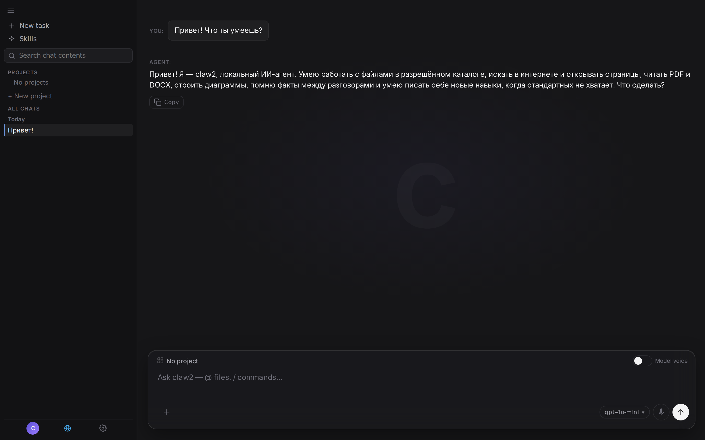
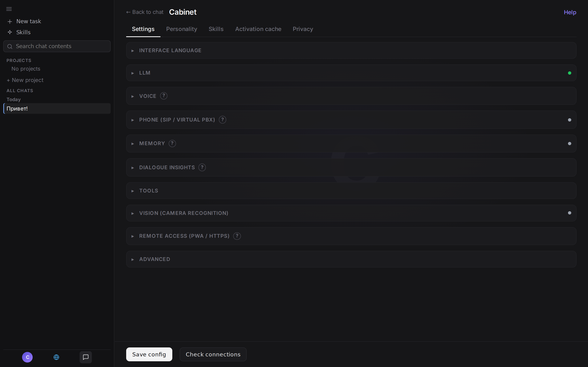

# claw2

[English](README.md) · [Русский](README.ru.md)

[](LICENSE)
[](docs/wiki/ru/Home.md)

**Персональный ИИ-агент, который вы размещаете сами.** Он работает с
провайдером языковых моделей на ваш выбор — облачным API или локальным
сервером вроде Ollama или LM Studio — и хранит разговоры, файлы и
долговременную память на вашей собственной машине. Всё, что не умеют
встроенные инструменты, агент делегирует навыку — обычному скрипту
Node.js, который он может написать сам и выполнить после вашего
подтверждения.

Безопасность включена по умолчанию: агент действует внутри ограниченной
песочницы, касается только разрешённых вами каталогов и записывает свои
действия в журнал аудита. Разговоры живут в локальной базе SQLite; облаку
они не отправляются — единственный исходящий трафик тот, что настроили вы.

Формат дистрибутива — исходный код для самостоятельного размещения:
достаточно машины под Linux с Docker, а один контейнер обслуживает и
веб-интерфейс, и API.

<p align="center">
  
  
</p>

## Быстрый старт

```bash
git clone https://github.com/bkisonka/claw2 claw2
cd claw2

# 1. Окружение: ключ модели и ключ доступа к шлюзу.
cp .env.example .env
openssl rand -hex 24   # сгенерируйте ключ шлюза
nano .env              # вставьте его в .env строкой CLAW2_GATEWAY_API_KEY=<сгенерированный ключ>;
                       # ключ провайдера модели — в OPENAI_API_KEY

# 2. Конфигурация: создайте конфиг агента из примера.
cp .claw2/claw2.gateway.yaml.example .claw2/claw2.yaml
nano .claw2/claw2.yaml

# 3. Сборка и запуск.
docker compose up -d --build
```

Откройте **http://localhost:8080** — веб-интерфейс агента; при входе он
запросит ключ шлюза. О состоянии здоровья сообщает `GET /health`.

По умолчанию порт публикуется только на loopback интерфейсе. Чтобы попасть
к агенту с других устройств, замените в `compose.yml` строку
`127.0.0.1:8080:3000` на `8080:3000` — авторизация шлюза (в примере конфига
включена) защищает сервис, когда порт становится доступен.

Если локальный сервер моделей работает на хосте (например, Ollama на порту
11434), контейнер обращается к нему по адресу
`http://host.docker.internal:11434/v1` — впишите его в `llm.baseURL`
в конфиге.

## Возможности

- **Диалоговый агент с инструментами.** Помимо ответов на вопросы claw2
  умеет читать и записывать файлы в рабочем каталоге, получать страницы из
  интернета, вести поиск, выполнять вычисления и вызывать свои навыки —
  выбирая инструмент самостоятельно, по описанию вашей просьбы.
- **Навыки.** Всё, что не умеют встроенные инструменты, передаётся навыку —
  небольшому скрипту Node.js в каталоге `agents/`. Стандартные навыки
  покрывают скачивание файлов, чтение документов PDF и DOCX, построение
  диаграмм, погоду и другое. Если подходящего навыка нет, агент может
  написать новый и начать им пользоваться после вашего подтверждения.
- **Форк и дублирование чатов.** Ответвляйте диалог от любого сообщения
  (кнопка форка рядом с «копировать» под каждым ответом) или дублируйте
  весь чат из меню боковой панели. Копия несёт историю, проект и модель;
  созданные файлы остаются общими для оригинала и его форков; сайдбар
  показывает родословную деревом, а удаление чата переподвешивает его
  форки на родителя — цепочка рассуждений не рвётся.
- **Кэш активации (опционально).** Экспортируйте траекторию удачного
  глубокого диалога в файл `.claw-cache` и засейте ею новый чат: новая
  сессия стартует в восстановленном контуре темы, а не с пустого поля.
  Управление — во вкладке «Кэш активации» кабинета (экспорт, импорт,
  выбор для чата); в compose-поставке держите каталог кэшей внутри
  подключённого тома `data/` (например `./data/claw-cache`), чтобы кэши
  переживали пересборку.
- **Устойчивость диалога (экспериментально).** Контур на уровне сессии
  следит за семантической энтропией и когерентностью по ходу разговора;
  когда нить начинает «разъезжаться», переводит модель в более строгий
  режим ответа и вспоминает, о чём была сессия. Каждый порог — видимое
  число в конфиге, весь слой отключается одним ключом для сравнения
  «до/после» (`orchestrator.hss.enabled`).
- **Долговременная память.** Агент запоминает факты между разговорами и
  вспоминает уместные перед каждым ответом. Память хранится локально.
- **Напоминания.** Разовые и периодические напоминания (ежедневно, раз в
  три дня, еженедельно) приходят в Telegram, когда срок наступает.
- **Веб-интерфейс.** Полноценный чат с сессиями, настройками и вложениями;
  его отдаёт тот же контейнер.
- **Мобильный веб-клиент.** Автономное устанавливаемое веб-приложение
  (по пути `/pwa/`), целиком работающее в браузере и обращающееся к
  провайдеру модели напрямую — удобно на телефоне, дома и в сети.
- **Мессенджеры.** Бот Telegram может служить ещё одной дверью к тому же
  агенту; голосовые сообщения он понимает и отвечает голосом, если
  настроена речевая служба.
- **Учёт окружения.** Каждый выход агента во внешний мир проходит
  через списки разрешений и попадает в журнал аудита.

## Как это устроено

| Часть | Где | Роль |
|-------|-----|------|
| Шлюз | `src/gateway/` | Сердце системы: HTTP API, чат-сессии, инструменты, навыки, память, каналы. Отдаёт веб-интерфейс и мобильный клиент. |
| Веб-интерфейс | `web/` | Браузерный фронтенд (React). |
| Мобильный веб-клиент | `pwa/` | Автономное веб-приложение: логика агента исполняется в браузере, данные остаются на устройстве. |
| Навыки | `agents/` | Небольшие скрипты Node.js, редактируемые на хосте, — контейнер подхватывает их на месте. |
| Персона ассистента | `prompts/` | Тон и манера ассистента, отделённые от механики. |
| Конфигурация | `.claw2/claw2.yaml` | Один YAML-файл для всего: модель, шлюз, память, инструменты, каналы. |

Разговоры живут в локальной базе SQLite; облаку они не отправляются.
Единственный исходящий трафик — тот, что вы настроили сами: обращения к
провайдеру модели и то, что агент получает по вашим поручениям.

## Требования

- Linux x86-64 или arm64 (подходят Debian, Ubuntu, Fedora, Alpine и другие
  распространённые дистрибутивы).
- Docker Engine 24 или новее с плагином Compose.
- Ключ API любого провайдера, совместимого с OpenAI, — облачного или
  локального сервера вроде LM Studio или Ollama.

Для сборки из исходников без Docker нужен Node.js 22.13 или новее (в CI используется Node.js 22).

## Конфигурация

Всё настраивается в одном YAML-файле, `.claw2/claw2.yaml`. Примеры в
каталоге `.claw2/` покрывают типовые сценарии; секреты никогда не пишутся в
сам файл — укажите `env:OPENAI_API_KEY`, и значение будет взято из
окружения (из `.env`).

Самые употребительные настройки:

```yaml
llm:
  provider: openai        # любой OpenAI-совместимый эндпоинт
  model: gpt-4o-mini
  baseURL: https://api.openai.com/v1   # или локальный сервер
  apiKey: env:OPENAI_API_KEY

gateway:
  port: 3000
  auth:
    enabled: true
    apiKey: env:CLAW2_GATEWAY_API_KEY

memory:
  enabled: true

sandbox:
  useDocker: false        # внутри контейнера навыки работают в node-песочнице
  timeoutMs: 60000
```

У веб-интерфейса есть собственный экран настроек, правящий тот же файл;
изменения вступают в силу по кнопке «Сохранить и перезапустить».

Переменные окружения (`cp .env.example .env`):

| Переменная | Назначение |
|------------|------------|
| `OPENAI_API_KEY` | Ключ провайдера модели; в конфиге ссылается через `env:OPENAI_API_KEY`. |
| `CLAW2_GATEWAY_API_KEY` | Ключ HTTP API и веб-интерфейса (требуется примером конфига). |
| `TZ` | Часовой пояс; агент ориентируется в текущих дате и времени, напоминания и расписания следуют ему. |

## Работа как системный сервис

В compose-файле уже объявлено `restart: unless-stopped`, поэтому агент
переживает перезагрузку хоста там, где демон Docker включён при загрузке.
Чтобы оформить стек как полноценный сервис systemd — с порядком зависимостей
и единой точкой управления через `systemctl` — см.
[docs/systemd.md](docs/systemd.md).

## Обновление

```bash
git pull
docker compose up -d --build
docker image prune -f   # необязательно: убрать старый висящий образ
```

Если вы правили файлы, находящиеся под git (чаще всего `compose.yml` —
публикация порта), сначала спрячьте правки: `git stash` → `git pull` →
`git stash pop`.

Конфигурация, разговоры и память живут в подключаемых томах (`.claw2/`,
`data/`) и при обновлении не затрагиваются. Изменения схемы базы данных,
если они есть в обновлении, применяются автоматически при первом старте
шлюза.

Контейнер egress-сайдкара пересоздаётся автоматически при первом запуске
навыка после смены образа (контейнер исполняет тот образ, из которого был
создан). В версиях без этой проверки удалите его один раз после обновления:
`docker rm -f claw2-egress-sidecar`.

### Автообновление (необязательно)

Кабинет сам проверяет выход новых релизов и показывает тост, когда версия
доступна; ссылка **Обновить** рядом со «Справка» открывает диалог обновления.
Чтобы запускать всё обновление прямо из браузера (с прогресс-баром), один раз
установите наблюдатель на хосте:

```bash
./scripts/update.sh --install   # systemd user-юнит; или: nohup ./scripts/update.sh --watch &
```

Наблюдатель опрашивает шлюз, обслуживает нажатия «Начать обновление»,
выполняет на хосте `git pull` + `docker compose up -d --build` + очистку
образов и возвращает прогресс в интерфейс. Грязное рабочее дерево он
обновлять откажется. Исходящая проверка релизов идёт на `api.github.com`;
отключается настройкой `updates.check: false` в конфиге.

## Навыки

Навыки живут в `agents/` как обычные файлы JavaScript. Контейнер
подключает этот каталог, поэтому навыки можно добавлять и править на хосте
любым редактором — агент видит изменения на следующем ходе. В этой
поставке каждый навык по умолчанию исполняется в жёсткой песочнице: как
одноразовый sibling-контейнер в изолированной docker-сети (внешних
маршрутов нет вообще), чей единственный выход — сайдкар egress-охраны:
loopback, приватные и metadata-адреса недостижимы из навыка, как и всё,
что не разрешено правилами guard'а (см. «Безопасность»). При установке на
хост без compose-стека навыки исполняются в процессе шлюза с флагами
`--permission` и `--no-addons` и охраной на уровне HTTP-стеков; там
`sandbox.useDocker: true` с локальным docker даёт ту же жёсткую изоляцию.

Когда существующего навыка не хватает, агент может написать новый — но
навык вне списка разрешений (поставляется в примере конфига) не
запустится, пока вы его не подтвердите: отправьте `/allow <имя>.js` в чат,
и навык сразу попадёт в `skills.allowlist` конфига. Чтобы агент мог
исполнять всё, что пишет, удалите секцию `skills.allowlist`.

Списки разрешённых путей и вебхуков также задаются в конфиге; всё за их
пределами отклоняется. Библиотеки, которыми пользуются поставляемые
навыки, предустановлены в образ; если вы замените подключаемый каталог
`agents/` своим, его локальный `node_modules` (если есть) имеет приоритет.

## Безопасность

- **Песочница.** Навыки исполняются изолированно, без доступа к файловой
  системе хоста за пределами рабочего каталога.
- **Списки разрешений.** Файловый доступ, исходящие вебхуки и загружаемые
  навыки перечислены в конфиге; остальное запрещено.
- **Авторизация шлюза.** Пример конфига поставляется с
  `gateway.auth.enabled: true`: API и веб-интерфейс требуют ключ
  (заголовок `X-API-Key` или `Authorization: Bearer`). Не выключайте её,
  когда порт доступен за пределами вашей машины — и тем более в общей сети:
  шлюз отвечает и на запросы со сторонних сайтов, открытых в вашем
  браузере, и именно ключ не пускает их внутрь.
- **Журнал аудита.** Ходы диалога, вызовы инструментов, файловые операции
  и отказы по соображениям безопасности дописываются в журнал; формат и
  место задаются в конфиге.
- **Сдерживание инъекций через промпт.** Содержимое, полученное из
  интернета, помечается как данные, но не как инструкции; сочетания
  доступа, делающие инъекцию опасной, распознаются и блокируются.
- **Охрана исходящих запросов.** `web_fetch` отказывает адресам, которые
  resolve-ются в петлевые, приватные или link-local (включая облачные
  метаданные), и проверяет каждый переход по редиректу. Чтобы агент мог
  обращаться к вашим локальным службам, задайте
  `tools.webFetch.allowPrivateHosts: true`.
- **Egress-охрана навыков (жёсткая по умолчанию).** Compose-поставка
  исполняет каждый навык одноразовым sibling-контейнером в изолированной
  docker-сети без внешних маршрутов — изоляция на уровне ядра, и
  единственный выход наружу — выделенный сайдкар с guard-прокси. Всё, что
  отправляет навык (`fetch`/`http`/`https` и любой сырой сокет), проходит
  те же SSRF-правила, что `web_fetch`: loopback, приватные, link-local и
  metadata-адреса отклоняются и логируются. При запуске навыков внутри
  шлюза (`sandbox.useDocker: false`) стандартные HTTP-стеки по-прежнему
  защищены, но сырые сокеты не изолированы. `sandbox.egress.mode: off`
  отключает эту защиту. При `sandbox.useDocker: true` такой режим возможен
  только при прямом подключении к Docker, не через API-guard в Compose.
- **Валидируемый доступ к docker.** Шлюз общается с хостовым docker только
  через валидирующий API-guard (`src/sandbox/docker-guard.ts`, отдельный
  контейнер с docker.sock в режиме read-only на внутренней сети). Помимо
  allowlist'а вызовов (жизненный цикл контейнеров и сетей, скачивание
  образов, проверки живости — без exec, build, volumes и swarm) каждое
  создание контейнера проходит структурную валидацию: профиль изоляции
  обязателен (без capabilities, без эскалации привилегий, read-only
  корень), расширение привилегий отклоняется, источники bind'ов — только
  внутри корней песочницы. Навыки подключаются к заданной внутренней
  bridge-сети; отдельная внешняя bridge-сеть доступна только egress-сайдкару.
  Сам docker-сокет в контейнер шлюза не монтируется; коду
  навыков — в том числе написанных моделью — такой доступ не достаётся.
- **Проверяемая идентичность.** Распознавание «кто перед камерой» считается
  достоверным только тогда, когда сервис распознавания подписал вердикт
  общим секретом (`vision.recognizeSecret`, HMAC + окно свежести);
  неподписанные заявления об идентичности отвергаются целиком — ни
  привязки памяти, ни расширенных прав. Идентичность Telegram/VK приходит
  из payload самой платформы, полученного шлюзом, и не затронута.
- **Защита от чужих сайтов.** При выключенной авторизации шлюза запросы,
  у которых `Host` — не IP-адрес, не `localhost`, не `*.local` и не имя из
  `gateway.trustedHosts`, отклоняются: страница со стороннего сайта (или
  DNS-rebinding-домен) не сможет управлять агентом или читать ответы.
  При включённой авторизации всё закрывает ключ.

## Дополнительно: расширенный стек

Сценарий с одним контейнером покрывает персональную установку. Для более
тяжёлой нагрузки — многолетние разговоры, семантический поиск по памяти —
шлюз может передать хранение PostgreSQL, а векторный индекс — серверу
Chroma; поисковым бэкендом может служить экземпляр SearXNG. Это обычные
внешние сервисы: добавьте их в `compose.yml`, укажите `gateway.databaseUrl`
и `memory.chroma.url` и перезапустите. Именно так устроено референсное
развёртывание в авторском репозитории.

## Документация

Расширенное руководство пользователя — справка в формате wiki, на русском
и английском: страницы по фичам (кэш активации, стабилизатор диалога HSS,
проекты, динамический сайдбар) и how-to. В запущенной поставке её раздаёт
сам gateway: откройте **/wiki/** на вашем инстансе (ссылка «Справка» в
кабинете ведёт туда же). В репозитории те же страницы лежат в
[docs/wiki/ru/](docs/wiki/ru/Home.md) и
[docs/wiki/en/](docs/wiki/en/Home.md).

## Состав исходников

```
src/       шлюз, инструменты, память, безопасность, планировщик, каналы
web/       браузерный фронтенд (React)
pwa/       мобильный веб-клиент и Android-приложение (Capacitor)
agents/    навыки — небольшие скрипты Node.js
prompts/   персона ассистента
docs/      дополнительные руководства (systemd, руководство пользователя)
```

## Приложение для Android

Каталог `pwa/` содержит и Android-приложение: тот же агент в нативной
оболочке на базе Capacitor. Gradle-проект — в `pwa/android/`; для сборки
нужна Android Studio (или входящий в неё JDK и Android SDK). Пошаговое
руководство — устройство, хранение данных, команды сборки, релизная
подпись — в [pwa/ANDROID.md](pwa/ANDROID.md).

Ключ релизной подписи сознательно не входит в исходники: создайте
собственный keystore и впишите его путь и пароли в
`pwa/android/keystore.properties` — релизная сборка подхватит их сама.
Сгенерированные веб-ресурсы и выходные сборки игнорируются git и
воссоздаются командой `npx cap sync` перед первой сборкой.

## Лицензия

claw2 — свободное программное обеспечение: вы можете распространять и/или
изменять его на условиях **GNU Affero General Public License v3.0**
([AGPL-3.0-only](LICENSE)), опубликованной Free Software
Foundation. Кратко: claw2 можно использовать, изучать, изменять и
распространять для любых целей, включая коммерческие; распространяемые
изменённые версии обязаны оставаться открытыми под AGPL-3.0-only; а если
вы запускаете изменённую версию как сетевой сервис — вы обязаны предоставить
её пользователям исходный код вашей версии (раздел 13 AGPL). Гарантии не
предоставляются — в объёме, допустимом законом.

Ядро HSS (`hss.cjs` — модель состояний устойчивости диалога) лицензируется
отдельно по [LGPL-3.0-only](LICENSE-HSS.md), совместимой с AGPL-3.0:
его можно изучать, изменять и распространять на условиях LGPL, а изменённые
версии обязаны оставаться под LGPL — улучшения ядра возвращаются в проект.

Сторонние компоненты с открытым кодом сохраняют собственные лицензии —
см. [NOTICE](NOTICE). Вклады принимаются под AGPL-3.0-only через CLA —
как подписать, см. [CONTRIBUTING.md](CONTRIBUTING.md). Коммерческое
лицензирование доступно по запросу — обращайтесь к правообладателю через
репозиторий. Наименование
«claw2» и логотипы проекта — товарные знаки правообладателя: лицензия даёт
права на код, но не на бренд.
